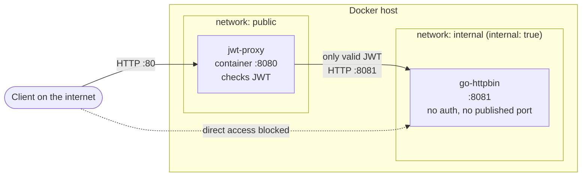
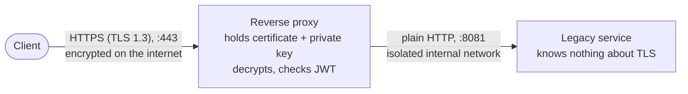
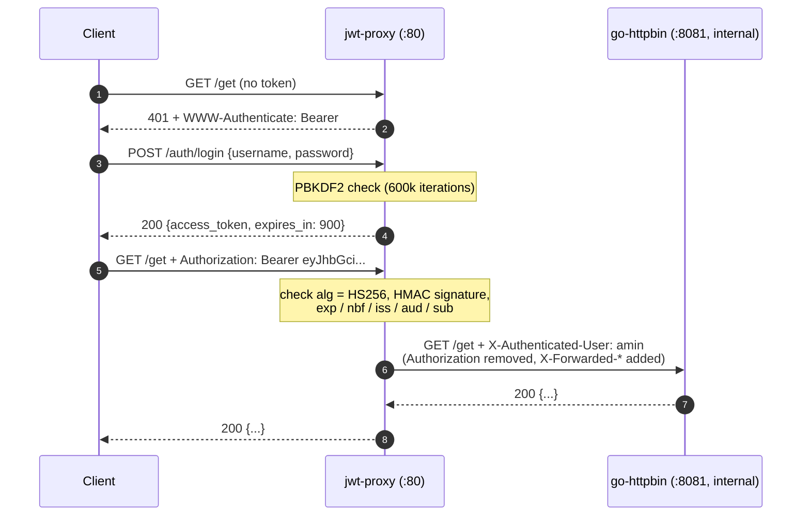

<div dir="rtl">

# تمرین عملی HTTP — Reverse Proxy با احراز هویت JWT

**درس مهندسی اینترنت — پاییز ۱۴۰۵**

| | |
|---|---|
| **نام و نام خانوادگی** | محمد امین فرح‌بخش |
| **شماره دانشجویی** | 40131029 |

## فهرست

- [معماری کلی](#arch)
- [بخش ۱ — اجرای سرویس فقط روی شبکهٔ داخلی](#part1)
- [بخش ۲ — فلسفهٔ TLS Termination](#part2)
- [بخش ۳ — پیاده‌سازی JWT Authentication Proxy](#part3)
  - [اجرا](#run) · [endpointها](#endpoints) · [تنظیمات](#config) · [روند یک درخواست](#flow) · [تصمیم‌های امنیتی](#security) · [تست‌ها](#tests) · [ساختار کد](#code) · [محدودیت‌ها](#limits)
- [استفاده از ابزارهای هوش مصنوعی](#ai)

<a name="arch"></a>
## معماری کلی

سرویس قدیمی ([go-httpbin](https://github.com/mccutchen/go-httpbin)) هیچ احراز هویتی ندارد. یک reverse proxy که خودم با Go نوشته‌ام تنها نقطهٔ ورود از اینترنت و از ماشین‌های دیگر است: روی پورت **۸۰** درخواست‌ها را می‌گیرد، توکن JWT را بررسی می‌کند و فقط درخواست‌های معتبر را به پورت **۸۰۸۱** سرویس در شبکهٔ داخلی می‌فرستد. سرویس قدیمی به شبکهٔ بیرونی وصل نیست و هیچ پورتی از آن منتشر نشده است.

</div>



<div dir="rtl">

---

<a name="part1"></a>
## بخش ۱ — چگونه یک سرویس را فقط روی شبکهٔ داخلی اجرا کنیم؟ (۵ نمره)

یک سرویس فقط وقتی از بیرون در دسترس است که **دو شرط** هم‌زمان برقرار باشد: (۱) روی یک interface شبکه که از بیرون قابل دسترسی است **listen** کند، و (۲) **مسیر شبکه** (routing، NAT، فایروال) اجازهٔ رسیدن بسته‌ها را بدهد. پس می‌توان در چند لایه جلوی دسترسی را گرفت. بهتر است چند لایه با هم استفاده شود (**defense in depth**) تا اشتباه در یک لایه، سرویس را لو ندهد.

### ۱) آدرس bind

هر سرور هنگام شروع یک آدرس IP و پورت را **bind** می‌کند:

| آدرس bind | چه کسی می‌تواند وصل شود؟ |
|---|---|
| `0.0.0.0` (یا `::`) | همه، از روی **همهٔ** interfaceها، از جمله interface متصل به اینترنت |
| `127.0.0.1` (loopback) | فقط برنامه‌های **همان ماشین** |
| یک IP خصوصی، مثلاً `10.0.0.5` | فقط ماشین‌هایی که به آن شبکهٔ داخلی دسترسی دارند |

go-httpbin به‌صورت پیش‌فرض روی `0.0.0.0:8080` گوش می‌دهد، ولی با متغیر `HOST` و `PORT` (یا فلگ‌های `-host` و `-port`) قابل تغییر است. مثلاً اجرای مستقیم روی یک سرور بدون Docker:

</div>

```bash
HOST=127.0.0.1 PORT=8081 go-httpbin   # only reachable from this machine
ss -tlnp | grep 8081                  # check: should show 127.0.0.1:8081, not 0.0.0.0:8081
```

<div dir="rtl">

### ۲) Docker: منتشر نکردن پورت و شبکهٔ `internal`

- **پورت را publish نکنیم.** کانتینری که بخش `ports:` ندارد، فقط از داخل شبکهٔ Docker خودش قابل دسترسی است. (`expose:` فقط مستندسازی است و چیزی را باز نمی‌کند.)
- **شبکهٔ `internal: true`.** Docker برای این شبکه هیچ gateway به بیرون نمی‌سازد؛ نه از بیرون می‌توان به کانتینرهای آن رسید و نه آن کانتینرها می‌توانند به اینترنت وصل شوند. یعنی اگر سرویس قدیمی آسیب‌پذیر باشد و نفوذی رخ دهد، مهاجم از آن کانتینر هم راهی به اینترنت ندارد.
- **اگر لازم شد پورت را برای دیباگ منتشر کنیم**، آن را به loopback ببندیم: `"127.0.0.1:8081:8081"`، نه `"8081:8081"`.
- **یک دام رایج:** `-p 8081:8081` روی `0.0.0.0` باز می‌شود و ترافیکِ پورت منتشرشده در iptables با DNAT به کانتینر فرستاده می‌شود و از زنجیره‌های `FORWARD` و `DOCKER` عبور می‌کند، نه از زنجیرهٔ `INPUT` که قوانین UFW در آن هستند. یعنی ممکن است فکر کنیم با `ufw deny 8081` پورت را بسته‌ایم ولی سرویس از اینترنت باز باشد. قانون‌های محدودکننده برای کانتینرها باید در زنجیرهٔ `DOCKER-USER` نوشته شوند.

### ۳) فایروال میزبان

حتی اگر سرویس روی همهٔ interfaceها گوش دهد، فایروال (nftables، iptables یا ufw) می‌تواند پورت را فقط برای شبکهٔ داخلی باز کند:

</div>

```bash
# allow port 8081 only from the internal subnet, drop it from everywhere else
iptables -A INPUT -p tcp --dport 8081 -s 10.0.0.0/8 -j ACCEPT
iptables -A INPUT -p tcp --dport 8081 -j DROP
```

<div dir="rtl">

### ۴) تفکیک شبکه (Network Segmentation)

در زیرساخت واقعی، سرور سرویس قدیمی اصلاً **IP عمومی ندارد** و در یک subnet خصوصی یا VLAN جدا قرار می‌گیرد. در فضای ابری این یعنی private subnet بدون Internet Gateway، به همراه **Security Group** که پورت ۸۰۸۱ را فقط برای Security Group پروکسی باز می‌کند. در Kubernetes هم معادلش Service از نوع **`ClusterIP`** (پیش‌فرض، فقط داخل کلاستر) به همراه **`NetworkPolicy`** است که فقط به podهای پروکسی اجازهٔ اتصال می‌دهد.

### آنچه در این پروژه انجام دادم

در `docker-compose.yml` دو شبکه تعریف کرده‌ام:

- `public`: فقط پروکسی به آن وصل است و پورت ۸۰ میزبان به پورت ۸۰۸۰ کانتینر پروکسی منتشر شده است.
- `internal` با `internal: true`: هم پروکسی و هم httpbin به آن وصل‌اند.

httpbin فقط به `internal` وصل است، با `PORT=8081` اجرا می‌شود و **هیچ بخش `ports:` ندارد**. پروکسی تنها کانتینری است که در هر دو شبکه حضور دارد، پس برای ماشین‌های دیگر تنها پل رسیدن به سرویس قدیمی است. (روی خود میزبان Docker، کاربری با دسترسی root هنوز می‌تواند با IP داخلی کانتینر به آن وصل شود؛ مرز امنیتی اینجا شبکه است، نه میزبان.) بررسی:

</div>

```bash
docker compose ps                                  # httpbin has no published port
curl -m 3 http://localhost:8081/get                # fails: nothing listens on the host
docker network inspect http-hands-on_internal --format '{{.Internal}}'   # true

# from inside the internal network the service IS reachable (this is how the proxy talks to it):
docker run --rm --network http-hands-on_internal curlimages/curl -s http://httpbin:8081/get
```

<div dir="rtl">

---

<a name="part2"></a>
## بخش ۲ — فلسفهٔ TLS Termination (۵ نمره)

### TLS Termination چیست؟

در TLS Termination، **reverse proxy در لبهٔ شبکه** گواهی (certificate) و کلید خصوصی را نگه می‌دارد، handshake ‏TLS را با کلاینت کامل می‌کند، ترافیک را **رمزگشایی** می‌کند و درخواست را به‌صورت HTTP ساده از طریق شبکهٔ داخلی مورد اعتماد به سرویس پشتی می‌فرستد. یعنی اتصال رمزشدهٔ کلاینت در پروکسی «تمام» (terminate) می‌شود.

</div>



<div dir="rtl">

### فلسفه: چرا این کار را می‌کنیم؟

**۱. اضافه کردن امنیت بدون دست زدن به سرویس قدیمی.** سرویس قدیمی یا اصلاً TLS را پشتیبانی نمی‌کند یا فقط نسخه‌های قدیمی و ناامن (SSLv3، TLS 1.0) را می‌شناسد، و تغییر کدش پرهزینه یا غیرممکن است. پروکسی رمزنگاری مدرن را **از بیرون** به سرویس اضافه می‌کند. این همان فلسفهٔ احراز هویت JWT در بخش ۳ است: **قابلیت‌های امنیتی در لبه و در یک جا پیاده‌سازی می‌شوند** و سرویس فقط کار اصلی خودش را انجام می‌دهد (separation of concerns).

**۲. JWT بدون TLS امن نیست.** توکن Bearer یعنی «هر کس آن را داشته باشد، صاحبش است». اگر توکن روی HTTP ساده فرستاده شود، هر کسی در مسیر (Wi‑Fi عمومی، ISP) می‌تواند آن را بخواند و تا پایان اعتبارش از طرف کاربر درخواست بفرستد (**replay**). رمز عبور هنگام لاگین هم به همین شکل لو می‌رود. به همین دلیل RFC 6750 استفاده از TLS را برای Bearer token **الزامی** می‌داند. پس TLS Termination و احراز هویت JWT **مکمل هم‌اند**، نه جایگزین هم: JWT می‌گوید «چه کسی»، TLS تضمین می‌کند که این اطلاعات در مسیر دزدیده یا دستکاری نشود.

**۳. پروکسی باید متن درخواست را ببیند.** برای بررسی هدر `Authorization`، مسیریابی بر اساس path، WAF، لاگ، کش و فشرده‌سازی، پروکسی باید درخواست را **رمزگشایی‌شده** ببیند. اگر TLS تا سرویس پشتی ادامه داشت و پروکسی آن را باز نمی‌کرد (TLS passthrough)، اصلاً نمی‌توانست JWT را بررسی کند.

**۴. مدیریت متمرکز گواهی و سیاست TLS.** گواهی‌ها فقط در یک جا نگهداری و به‌صورت خودکار تمدید می‌شوند (ACME / Let's Encrypt). حداقل نسخهٔ TLS، cipherهای مجاز و HSTS هم فقط در یک جا تنظیم می‌شوند، نه در ده سرویس مختلف که هر کدام زبان و کتابخانهٔ خودشان را دارند. کلید خصوصی هم فقط روی یک ماشین است، نه روی همهٔ سرورها.

**۵. بار پردازشی و پروتکل‌های جدید.** هزینهٔ CPU برای handshake و رمزنگاری از روی سرویس‌های پشتی برداشته می‌شود و session resumption متمرکز می‌شود. پروکسی می‌تواند با کلاینت **HTTP/2 یا HTTP/3** صحبت کند در حالی که سرویس قدیمی همچنان HTTP/1.1 ساده می‌فهمد. (در تست پروکسی همین پروژه، `curl` با پروکسی روی HTTP/2 مذاکره کرد و پروکسی با httpbin روی HTTP/1.1 صحبت کرد.)

### هزینه‌ها و ریسک‌ها

- **ترافیک داخلی رمزنشده است.** هر کسی که به شبکهٔ داخلی دسترسی پیدا کند می‌تواند ترافیک (و هدر `X-Authenticated-User`) را ببیند یا جعل کند. پس شبکهٔ داخلی باید واقعاً ایزوله باشد (کاری که در بخش ۱ انجام دادم). در محیط‌های حساس یا مدل **Zero Trust** از TLS Bridging یا mTLS استفاده می‌شود.
- **پروکسی هدف ارزشمندی است.** کلید خصوصی و همهٔ ترافیک رمزگشایی‌شده در آن است، پس باید کمینه، به‌روز و سخت‌سازی‌شده باشد (در این پروژه: ایمیج distroless، کاربر غیر root، فایل‌سیستم read-only، بدون capability).
- **سرویس پشتی باید بداند درخواست اصلی HTTPS بوده.** این اطلاعات با هدر `X-Forwarded-Proto: https` منتقل می‌شود (پروکسی من آن را با `SetXForwarded` می‌فرستد).

### مقایسهٔ حالت‌ها

| حالت | پروکسی ترافیک را می‌بیند؟ | ترافیک داخلی | کاربرد |
|---|---|---|---|
| **TLS Termination** | بله | HTTP ساده | سرویس قدیمی بدون TLS در شبکهٔ امن (همین تمرین) |
| **TLS Bridging / Re-encryption** | بله | دوباره رمز می‌شود | شبکهٔ داخلی غیرقابل اعتماد، الزامات قانونی |
| **TLS Passthrough** | خیر (فقط SNI) | رمز انتها به انتها | وقتی پروکسی نباید محتوا را ببیند؛ ولی بررسی JWT ممکن نیست |
| **mTLS تا سرویس** | بله | رمز + احراز هویت دوطرفه با گواهی | Zero Trust، service mesh |

### TLS در این پروژه

طبق صورت تمرین، پروکسی به‌صورت پیش‌فرض روی پورت ۸۰ (HTTP) کار می‌کند. اما TLS Termination را هم پیاده‌سازی کرده‌ام: اگر دو متغیر `TLS_CERT_FILE` و `TLS_KEY_FILE` تنظیم شوند، پروکسی خودش TLS را terminate می‌کند (حداقل TLS 1.2). تست محلی با گواهی self-signed:

</div>

```bash
openssl req -x509 -newkey rsa:2048 -nodes -keyout key.pem -out cert.pem -days 30 \
  -subj "/CN=localhost" -addext "subjectAltName=DNS:localhost"

cd proxy
LISTEN_ADDR=:8443 TLS_CERT_FILE=../cert.pem TLS_KEY_FILE=../key.pem \
UPSTREAM_URL=http://127.0.0.1:8081 USERS_FILE=../config/users.json \
JWT_SECRET="$(openssl rand -base64 48)" go run .

curl --cacert ../cert.pem https://localhost:8443/healthz      # ok (negotiated over HTTP/2)
```

<div dir="rtl">

در محیط واقعی باید پورت ۴۴۳ با گواهی معتبر (Let's Encrypt) استفاده شود و پورت ۸۰ فقط درخواست‌ها را با `308` به HTTPS هدایت کند.

---

<a name="part3"></a>
## بخش ۳ — پیاده‌سازی JWT Authentication Proxy (۱۰ نمره)

صورت تمرین اجازه می‌دهد پروکسی یا با پیکربندی ابزارهای آماده (nginx، Traefik، …) ساخته شود یا برنامه‌نویسی شود. من آن را با **Go و فقط با کتابخانهٔ استاندارد** نوشتم:

- **می‌توانم هر خط را توضیح دهم:** حتی تأیید امضای JWT را خودم نوشته‌ام (حدود ۱۰۰ خط) به‌جای استفاده از یک کتابخانهٔ جعبه‌سیاه.
- **بدون وابستگی خارجی:** هیچ پکیج شخص ثالثی در کد وجود ندارد، پس ریسک supply chain بسیار کمتر است (فقط ایمیج‌های پایهٔ Docker باقی می‌مانند). رمزنگاری (`crypto/hmac`، `crypto/pbkdf2`) و reverse proxy ‏(`net/http/httputil`) همه از کتابخانهٔ استاندارد Go هستند.
- **سازگار با استاندارد:** توکن‌های ساخته‌شده با کتابخانهٔ PyJWT را تأیید می‌کند (در تست‌های واحد) و توکن‌هایی که خودش می‌سازد هم با PyJWT تأیید می‌شوند (در تست دستی).

<a name="run"></a>
### اجرا

پیش‌نیاز: Docker و Docker Compose.

</div>

```bash
# 1) create a strong secret for signing tokens (the proxy refuses secrets < 32 bytes)
echo "JWT_SECRET=$(openssl rand -base64 48)" > .env

# 2) build the proxy, pull go-httpbin, start both
docker compose up --build -d

# 3) run the scripted walkthrough (401 → login → 200 → forged token → 401)
./scripts/demo.sh
```

<div dir="rtl">

کاربر نمونه: نام کاربری `amin` و رمز `ie-http-1405` (فقط هش آن در `config/users.json` ذخیره شده است).

**استفادهٔ دستی با curl:**

</div>

```bash
# without a token → 401
curl -i http://localhost/get

# log in → JWT
TOKEN=$(curl -s -X POST http://localhost/auth/login \
  -H 'Content-Type: application/json' \
  -d '{"username":"amin","password":"ie-http-1405"}' | sed -n 's/.*"access_token":"\([^"]*\)".*/\1/p')

# with the token → the request reaches go-httpbin
curl http://localhost/headers -H "Authorization: Bearer $TOKEN"
```

<div dir="rtl">

**افزودن کاربر جدید:** رمز را به دستور `hash-password` بدهید و خروجی را در `config/users.json` بگذارید، سپس پروکسی را restart کنید:

</div>

```bash
printf '%s\n' 'a-strong-password' | docker compose run --rm --no-deps -T proxy hash-password
# → pbkdf2-sha256$600000$...$...   add it as  "username": "<hash>"  in config/users.json
docker compose restart proxy
```

<div dir="rtl">

**اجرای بدون Docker** (برای توسعه): go-httpbin را روی `127.0.0.1:8081` اجرا کنید، سپس:

</div>

```bash
cd proxy
LISTEN_ADDR=:8080 UPSTREAM_URL=http://127.0.0.1:8081 USERS_FILE=../config/users.json \
JWT_SECRET="$(openssl rand -base64 48)" go run .
```

<div dir="rtl">

<a name="endpoints"></a>
### Endpointها

| مسیر | احراز هویت | کار |
|---|---|---|
| `GET /healthz` | ندارد | بررسی سلامت پروکسی؛ پاسخ `ok` |
| `POST /auth/login` | ندارد | بدنهٔ `{"username","password"}` را می‌گیرد و توکن برمی‌گرداند |
| هر مسیر و متد دیگر | **JWT لازم است** | پس از تأیید توکن به go-httpbin فرستاده می‌شود |

پاسخ لاگین موفق، با نام فیلدهای استاندارد OAuth 2.0 ‏(RFC 6749):

</div>

```json
{"access_token": "eyJhbGciOiJIUzI1NiIs...", "token_type": "Bearer", "expires_in": 900}
```

<div dir="rtl">

| وضعیت | کد | توضیح |
|---|---|---|
| بدون توکن | `401` | همراه با `WWW-Authenticate: Bearer realm="legacy-httpbin"` |
| توکن نامعتبر / منقضی / جعلی | `401` | همراه با `error="invalid_token"` (طبق RFC 6750)؛ دلیل دقیق فقط در بدنهٔ JSON و لاگ |
| رمز یا نام کاربری اشتباه | `401` | پیام یکسان برای هر دو حالت، همراه با `WWW-Authenticate` |
| بدنهٔ لاگین نامعتبر (JSON نادرست، فیلد ناشناخته، دادهٔ اضافه) | `400` | |
| متد غیر از POST برای لاگین | `405` | همراه با هدر `Allow: POST` |
| سرویس پشتی در دسترس نیست | `502` | |
| سرویس پشتی در ۳۰ ثانیه پاسخ نداد | `504` | |

<a name="config"></a>
### تنظیمات (متغیرهای محیطی)

| متغیر | پیش‌فرض | توضیح |
|---|---|---|
| `JWT_SECRET` | — (اجباری) | کلید HMAC؛ حداقل ۳۲ بایت، وگرنه پروکسی اجرا نمی‌شود |
| `UPSTREAM_URL` | — (اجباری) | آدرس سرویس قدیمی، مثلاً `http://httpbin:8081` |
| `LISTEN_ADDR` | `:8080` | آدرس و پورتی که پروکسی گوش می‌دهد |
| `JWT_ISSUER` | `jwt-proxy` | مقدار claim ‏`iss` |
| `JWT_AUDIENCE` | `legacy-httpbin` | مقدار claim ‏`aud` و realm در `WWW-Authenticate` |
| `TOKEN_TTL` | `15m` | عمر توکن |
| `USERS_FILE` | `/etc/jwt-proxy/users.json` | فایل کاربران و هش رمزها |
| `TLS_CERT_FILE` / `TLS_KEY_FILE` | خالی | اگر هر دو تنظیم شوند، TLS Termination فعال می‌شود |

پروکسی هنگام شروع **همهٔ** خطاهای تنظیمات را با هم گزارش می‌کند و با تنظیمات ناقص اجرا نمی‌شود (fail fast).

<a name="flow"></a>
### روند یک درخواست

</div>



<div dir="rtl">

<a name="security"></a>
### تصمیم‌های امنیتی و دلیل هر کدام

**در تأیید JWT** (`internal/jwt/jwt.go`):

- **الگوریتم ثابت `HS256`.** فیلد `alg` توکن از طرف مهاجم کنترل می‌شود؛ اگر به آن اعتماد کنیم، حملهٔ معروف `"alg": "none"` (توکن بدون امضا) یا key confusion ممکن می‌شود. پروکسی هر الگوریتمی غیر از HS256 را رد می‌کند.
- **ترتیب بررسی:** اول header، بعد **امضا**، و فقط بعد از تأیید امضا محتوای payload خوانده و بررسی می‌شود. به دادهٔ امضانشده اعتماد نمی‌کنیم.
- **مقایسه در زمان ثابت** (`hmac.Equal`) تا مهاجم نتواند از روی زمان پاسخ، امضای درست را بایت به بایت حدس بزند (timing attack).
- **بررسی کامل claimها:** `exp` (اجباری)، `nbf`، `iss`، `aud` و `sub`؛ با ۳۰ ثانیه leeway برای اختلاف ساعت سرورها. بررسی `aud` جلوی این را می‌گیرد که توکنی که برای سرویس دیگری با همان کلید صادر شده اینجا پذیرفته شود.
- **کلید حداقل ۳۲ بایت** (RFC 7518)، و پذیرفتن فقط کاراکترهای base64url و نقطه همراه با decode سخت‌گیرانه (`Strict`) تا یک توکن دو شکل نوشتاری نداشته باشد (decoder استاندارد Go کاراکترهای `\r` و `\n` را نادیده می‌گیرد، پس این بررسی جداگانه لازم است).
- **عمر کوتاه توکن** (۱۵ دقیقه) تا اگر توکنی لو رفت، مدت کوتاهی قابل استفاده باشد.

**در لاگین و رمزها** (`internal/auth`):

- **رمز هرگز به‌صورت متن ساده ذخیره نمی‌شود.** هش PBKDF2-HMAC-SHA256 با salt تصادفی و ۶۰۰٬۰۰۰ تکرار (مقدار توصیه‌شدهٔ OWASP) تا حدس زدن رمز از روی هش بسیار کند باشد.
- **پیام یکسان** برای «کاربر وجود ندارد» و «رمز اشتباه است»، و **زمان یکسان**: برای کاربر ناموجود هم یک هش ساختگی محاسبه می‌شود تا نتوان از روی زمان پاسخ کاربران واقعی را پیدا کرد (user enumeration؛ همان نکتهٔ سوال ۵ تمرین تئوری).
- **`Cache-Control: no-store`** روی پاسخ توکن، حداکثر ۴ کیلوبایت برای بدنهٔ لاگین و رد کردن فیلدهای ناشناخته.

**در پروکسی** (`internal/proxy/proxy.go`):

- **حذف هدر `Authorization`** قبل از فرستادن به سرویس قدیمی؛ آن سرویس به توکن نیازی ندارد و نباید credential را ببیند یا در لاگ‌هایش ذخیره کند.
- **هدر `X-Authenticated-User` فقط از توکن تأییدشده ساخته می‌شود** و هر مقداری که کلاینت فرستاده باشد حذف می‌شود، **با هر املایی**، از جمله `X_Authenticated_User`. در غیر این صورت هر کسی می‌توانست بنویسد `X-Authenticated-User: admin`؛ و چون بسیاری از backendها (CGI، PHP، WSGI، Rack) خط تیره و زیرخط را هر دو به `HTTP_X_AUTHENTICATED_USER` تبدیل می‌کنند، حذف فقط شکل خط‌تیره‌دار کافی نیست.
- **هدرهای `X-Forwarded-*` جعلی کلاینت حذف می‌شوند** و پروکسی مقدار واقعی را می‌گذارد (حالت `Rewrite` در `httputil.ReverseProxy`).
- **هدر `Host` اصلی حفظ می‌شود** تا redirectها و لینک‌هایی که سرویس قدیمی می‌سازد به پروکسی اشاره کنند، نه به آدرس داخلی `httpbin:8081` که از بیرون قابل دسترسی نیست.
- **بدون بافر کردن پاسخ** (`FlushInterval: -1`): هر تکه از پاسخ سرویس بلافاصله به کلاینت فرستاده می‌شود، پس پاسخ‌های استریمی یا کند (مثل `/drip` و `/stream` در httpbin) دقیقاً مثل حالت بدون پروکسی رفتار می‌کنند.
- **timeout** برای پاسخ سرویس پشتی (`504` اگر دیر جواب دهد، `502` اگر در دسترس نباشد؛ همان تفاوتی که در سوال ۵ تمرین تئوری آمده) و برای اتصال‌های کلاینت: `ReadHeaderTimeout` در برابر Slowloris (ارسال خیلی کند هدرها) و `WriteTimeout` در برابر slow read؛ و **graceful shutdown** با `SIGTERM` در کمتر از مهلت ۱۰ ثانیه‌ای Docker.

**در Docker:** ایمیج distroless بدون shell، اجرا با کاربر غیر root، فایل‌سیستم read-only، حذف همهٔ capabilityها و `no-new-privileges`.

<a name="tests"></a>
### تست‌ها

</div>

```bash
cd proxy
go test -race ./...
```

<div dir="rtl">

| بسته | چه چیزی تست می‌شود |
|---|---|
| `internal/jwt` | صدور و تأیید توکن؛ تأیید توکن‌های ساخته‌شده با **PyJWT**؛ رد کردن ۱۹ حالت نامعتبر: `alg: none`، ‏HS512، ‏RS256، payload دستکاری‌شده، کلید اشتباه، منقضی، `nbf` آینده، `iss`/`aud` اشتباه، بدون `sub`، base64 نادرست، کاراکتر خط جدید داخل توکن، توکن خیلی بلند، … |
| `internal/auth` | هش رمز و salt تصادفی؛ هش‌های نامعتبر؛ همهٔ حالت‌های endpoint لاگین (۲۰۰، ۴۰۰، ۴۰۱ همراه با `WWW-Authenticate`، ۴۰۵)؛ middleware با و بدون توکن، توکن منقضی، و اینکه متن توکن مهاجم در هدر `WWW-Authenticate` کپی نشود |
| `internal/proxy` | حفظ path و query؛ حذف `Authorization`؛ خنثی شدن جعل `X-Authenticated-User` (با خط تیره و زیرخط) و `X-Forwarded-For`؛ حفظ `Host` عمومی؛ نرسیدن درخواست بدون توکن به سرویس؛ استریم شدن پاسخ بدون بافر؛ `502` وقتی سرویس پایین است و `504` وقتی دیر جواب می‌دهد |
| `jwtproxy` (main) | کل مسیر: اول `401`، بعد لاگین و گرفتن توکن، و در نهایت `200`؛ اعتبارسنجی تنظیمات؛ دستور `hash-password` |

علاوه بر این، پروکسی را end-to-end جلوی httpbin اجرا کردم و `scripts/demo.sh` همهٔ مراحل را نشان می‌دهد. خلاصهٔ خروجی:

</div>

```text
== 1) Request without a token is rejected          -> HTTP 401  (WWW-Authenticate: Bearer realm="legacy-httpbin")
== 2) Login with a wrong password                  -> HTTP 401  {"error":"invalid_credentials", ...}
== 3) Login with the right password                -> {"access_token":"eyJ...","token_type":"Bearer","expires_in":900}
== 4) Same request with the token                  -> HTTP 200  (httpbin sees X-Authenticated-User = amin and no Authorization header)
== 5) POST /anything                               -> HTTP 200
== 6) Forged token (payload changed to sub=admin)  -> HTTP 401  {"error":"invalid_token","message":"signature is invalid"}
== 7) GET /status/418 passes through               -> HTTP 418
```

<div dir="rtl">

<a name="code"></a>
### ساختار کد

</div>

```text
.
├── docker-compose.yml        two networks; httpbin only on the internal one
├── .env.example              JWT_SECRET template (real .env is git-ignored)
├── config/users.json         username → PBKDF2 hash
├── scripts/demo.sh           end-to-end walkthrough with curl
└── proxy/
    ├── Dockerfile            multi-stage build → distroless, non-root
    ├── main.go               start-up, HTTP server, timeouts, graceful shutdown, hash-password
    ├── config.go             environment variables → validated config
    ├── server.go             routes + access log middleware
    └── internal/
        ├── jwt/              HS256 issue/verify (RFC 7519) — the security core
        ├── auth/             password hashing, user store, /auth/login, RequireJWT middleware
        ├── proxy/            httputil.ReverseProxy: header rewriting, 502/504 handling
        └── httpjson/         uniform JSON error responses
```

<div dir="rtl">

هر بسته یک مسئولیت دارد و بسته‌ها از طریق interfaceهای کوچک (`TokenIssuer`، `TokenVerifier`) به هم وصل‌اند، پس هر بخش جداگانه تست می‌شود.

<a name="limits"></a>
### محدودیت‌ها و بهبودهای ممکن

- **محدودیت نرخ لاگین:** در حال حاضر فقط هزینهٔ PBKDF2 حمله brute force را کند می‌کند؛ بهتر است تعداد تلاش برای هر IP یا کاربر محدود شود و پاسخ `429` با `Retry-After` برگردد. همین هزینه (حدود ۰٫۳ ثانیه CPU برای هر لاگین) یک ریسک DoS هم هست؛ محدود کردن تعداد لاگین‌های هم‌زمان (مثلاً به تعداد هسته‌های CPU) و پاسخ `503` در صورت شلوغی آن را برطرف می‌کند.
- **ابطال توکن:** توکن تا پایان ۱۵ دقیقه معتبر می‌ماند. می‌توان فهرست سیاه `jti` یا refresh token با عمر بلندتر اضافه کرد.
- **امضای نامتقارن:** با RS256 یا EdDSA و JWKS، صدور توکن به یک Identity Provider جدا (مثل Keycloak) سپرده می‌شود و پروکسی فقط کلید عمومی را دارد.
- **HTTPS پیش‌فرض:** در محیط واقعی، پورت ۴۴۳ با گواهی معتبر و redirect پورت ۸۰ به HTTPS (بخش ۲).
- **ثابت کردن نسخهٔ ایمیج** go-httpbin با digest به‌جای `latest`.

---

<a name="ai"></a>
## استفاده از ابزارهای هوش مصنوعی

طبق قوانین تمرین، استفاده از هوش مصنوعی را اعلام می‌کنم:

- **ابزار:** Claude، ساخت شرکت Anthropic
- **نام مدل:** Claude Opus 5.5
- **تعداد پارامترها:** Anthropic این عدد را به‌طور عمومی منتشر نکرده است.
- **کاربرد:** کمک در طراحی ساختار پروژه، نوشتن و بازبینی کد Go و تست‌ها، پیکربندی Docker Compose، و تنظیم متن پاسخ بخش‌های ۱ و ۲. کد را خط به خط بررسی کرده‌ام و می‌توانم هر بخش آن را توضیح دهم.

</div>
