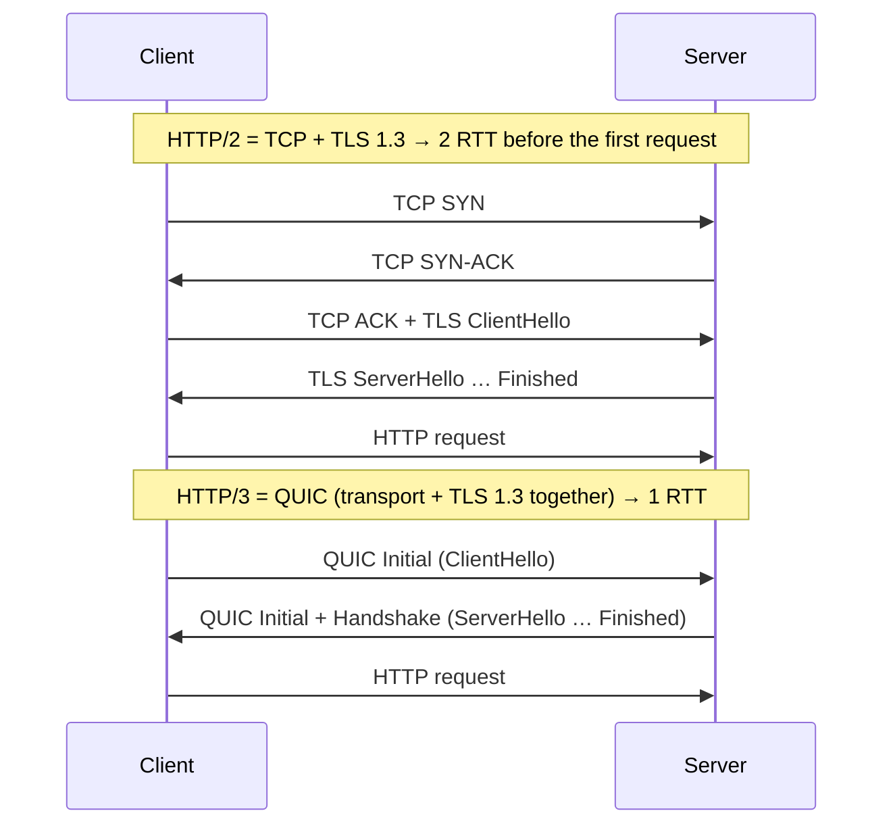
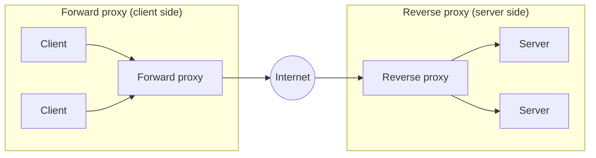

<div dir="rtl">

# تمرین HTTP — بخش تئوری

**درس مهندسی اینترنت — پاییز ۱۴۰۵**

| | |
|---|---|
| **نام و نام خانوادگی** | محمد امین فرح‌بخش |
| **شماره دانشجویی** | 40131029 |

## فهرست

- [سوال ۱ — تفاوت نسخه‌های HTTP و دلیل استفادهٔ HTTP/3 از UDP](#q1)
- [سوال ۲ — ارتباط stateless و stateful](#q2)
- [سوال ۳ — چالش «شروع ارتباط فقط از سمت کلاینت» و راهکارها](#q3)
- [سوال ۴ — اجزای URL](#q4)
- [سوال ۵ — انتخاب کد وضعیت HTTP](#q5)
- [سوال ۶ — نوع پروکسی](#q6)
- [منابع](#refs)
- [استفاده از ابزارهای هوش مصنوعی](#ai)

---

<a name="q1"></a>
## سوال ۱ — تفاوت نسخه‌های HTTP (۳ نمره)

### HTTP/0.9 — سال ۱۹۹۱

- درخواست **تک‌خطی**: فقط `GET /page.html`
- **فقط متد GET**
- **بدون هدر**، **بدون کد وضعیت**، حتی بدون شمارهٔ نسخه در درخواست
- پاسخ فقط **HTML خام**
- پایان پاسخ = **بسته شدن اتصال TCP** (یک اتصال برای هر درخواست)

### HTTP/1.0 — سال ۱۹۹۶ (RFC 1945)

- **شمارهٔ نسخه** در خط درخواست (`GET /x HTTP/1.0`)
- **کدهای وضعیت** (`200`، `404`، `500` …)
- **هدرها** در درخواست و پاسخ
- هدر **`Content-Type`** ← انتقال هر نوع محتوا (تصویر، فایل، …) نه فقط HTML
- متدهای جدید **`POST`** و **`HEAD`**
- کش ساده با `Expires` و `If-Modified-Since`
- هنوز **یک درخواست به ازای هر اتصال TCP** (Keep-Alive فقط به‌صورت غیراستاندارد)
- هدر `Host` الزامی نبود ← هر IP فقط یک وب‌سایت

### HTTP/1.1 — سال ۱۹۹۷ (اول RFC 2068، سپس 2616 و 7230؛ امروز RFC 9110 و 9112)

- **اتصال پایدار (persistent connection)** به‌صورت پیش‌فرض ← چند درخواست روی یک اتصال TCP
- **Pipelining** (فرستادن چند درخواست بدون انتظار)؛ عملاً بی‌استفاده ماند چون پاسخ‌ها باید به ترتیب برگردند
- هدر **`Host` اجباری** ← **Virtual Hosting** (چند سایت روی یک IP)
- **Chunked transfer encoding** ← پاسخ با طول نامعلوم و استریم
- متدهای `PUT`، `DELETE`، `OPTIONS`، `TRACE`، `CONNECT` (و بعدها `PATCH` در RFC 5789)
- کش پیشرفته: **`Cache-Control`**، **`ETag`**، درخواست شرطی (`If-None-Match`)
- **Range request** و کد `206` ← ادامهٔ دانلود
- **Content negotiation** با هدرهای `Accept-*`، و `100 Continue`
- پروتکل **متنی**
- مشکل: **Head-of-Line (HOL) Blocking در لایهٔ کاربرد**؛ یک پاسخ کند بقیه را معطل می‌کند ← مرورگرها حدود ۶ اتصال موازی به هر دامنه باز می‌کنند

### HTTP/2 — سال ۲۰۱۵ (اول RFC 7540؛ امروز RFC 9113)

- **باینری و مبتنی بر frame** به‌جای متن
- **Multiplexing**: چند stream هم‌زمان روی **یک** اتصال TCP ← حذف HOL در لایهٔ کاربرد
- **فشرده‌سازی هدر با HPACK**
- **Flow control** جداگانه برای هر stream
- اولویت‌بندی stream (طرح اولیه در RFC 9113 منسوخ شد و RFC 9218 جایگزینش شد)
- **Server Push** (در عمل شکست خورد؛ کروم از نسخهٔ ۱۰۶ آن را حذف کرد)
- **معنای** HTTP (متدها، هدرها، کدها) همان 1.1 است؛ فقط **شیوهٔ انتقال** عوض شد
- در عمل فقط روی **TLS** (مذاکره با ALPN و شناسهٔ `h2`)
- مشکل باقی‌مانده: **HOL Blocking در لایهٔ TCP**

### HTTP/3 — سال ۲۰۲۲ (RFC 9114)

- روی **QUIC** (RFC 9000) و QUIC روی **UDP**
- **TLS 1.3 درون خود QUIC** ← رمزنگاری همیشه فعال
- برقراری اتصال **با یک رفت‌وبرگشت (1-RTT)** و **0-RTT** در اتصال دوباره
- **Streamهای مستقل در لایهٔ انتقال** ← حذف HOL Blocking لایهٔ انتقال
- **Connection Migration** با Connection ID (جابه‌جایی Wi‑Fi ↔ اینترنت همراه بدون قطع اتصال)
- **فشرده‌سازی هدر با QPACK**
- کشف سرور از طریق هدر **`Alt-Svc`** یا رکورد DNS از نوع **`HTTPS`**
- پیاده‌سازی در **فضای کاربر (user space)** به‌جای کرنل

### جمع‌بندی

| نسخه | قالب پیام | اتصال | چند درخواست هم‌زمان | لایهٔ انتقال | فشرده‌سازی هدر |
|---|---|---|---|---|---|
| 0.9 | متن (یک خط) | یک درخواست، بعد بستن | ✗ | TCP | — |
| 1.0 | متن + هدر | یک درخواست، بعد بستن | ✗ | TCP | ✗ |
| 1.1 | متن + هدر | پایدار | ✗ (چند اتصال موازی) | TCP | ✗ |
| 2 | باینری (frame) | یک اتصال | ✓ multiplexing | TCP + TLS | HPACK |
| 3 | باینری (frame) | یک اتصال QUIC | ✓ streamهای مستقل | QUIC روی UDP | QPACK |

### چرا HTTP/3 از UDP استفاده می‌کند؟

نکتهٔ اصلی: هدف «استفاده از UDP» نبود؛ هدف ساختن یک **پروتکل انتقال جدید (QUIC)** بود که مشکلات TCP را نداشته باشد، و **UDP تنها بستر عملی** برای رساندن آن به همهٔ اینترنت بود. خود UDP قابل اعتماد نیست؛ اطمینان از تحویل، ترتیب، کنترل جریان و کنترل ازدحام را QUIC روی UDP پیاده‌سازی می‌کند. دلایل:

۱. **حذف HOL Blocking در TCP.** TCP یک جریان بایتی **مرتب** است. اگر یک بسته گم شود، همهٔ داده‌های بعدی، حتی آن‌هایی که مال streamهای دیگرند، تا بازارسال آن بسته معطل می‌مانند. پس multiplexing در HTTP/2 روی شبکهٔ پراتلاف (مثلاً موبایل) گاهی از HTTP/1.1 هم بدتر است. QUIC streamها را می‌شناسد و گم شدن یک بسته فقط همان stream را متوقف می‌کند.

۲. **کاهش تأخیر شروع اتصال.** در HTTP/2 اول handshake خود TCP (۱ RTT) و بعد handshake ‏TLS 1.3 (۱ RTT دیگر) انجام می‌شود. QUIC این دو را **یکی** می‌کند: ۱ RTT برای اتصال تازه و **0-RTT** برای اتصال دوباره به سروری که قبلاً دیده شده.

۳. **تحجر (ossification) و غیرممکن بودن تغییر TCP.** TCP در **کرنل** سیستم‌عامل‌ها پیاده‌سازی شده و به‌روزرسانی آن روی میلیاردها دستگاه سال‌ها طول می‌کشد. از آن بدتر، middleboxها (فایروال، NAT، load balancer) هدرهای TCP را بررسی و گاهی دستکاری می‌کنند و بسته‌هایی با گزینه‌های ناآشنا را دور می‌ریزند. یک پروتکل انتقال کاملاً جدید (مثل SCTP) هم از اکثر NATها و فایروال‌ها عبور نمی‌کند. ولی **UDP تقریباً همه‌جا عبور می‌کند** و هدرش فقط ۸ بایت است (پورت مبدأ و مقصد، طول، checksum)؛ یعنی یک «پاکت خالی» که QUIC همه‌چیز را درون آن و در **فضای کاربر** می‌سازد. نتیجه: QUIC با یک به‌روزرسانی مرورگر یا برنامه تغییر می‌کند، نه با به‌روزرسانی کرنل. QUIC حتی بیشتر هدرهای خودش را رمز می‌کند تا middleboxها دوباره به جزئیات آن وابسته نشوند.

۴. **Connection Migration.** اتصال TCP با چهارتایی (IP و پورت مبدأ، IP و پورت مقصد) شناخته می‌شود؛ با عوض شدن شبکهٔ گوشی، IP عوض و اتصال قطع می‌شود. QUIC اتصال را با **Connection ID** می‌شناسد و بعد از تغییر شبکه ادامه می‌دهد.

۵. **بازیابی بهتر از گم شدن بسته.** QUIC برای هر بسته (حتی بازارسال‌ها) شمارهٔ جدید و صعودی می‌گذارد؛ پس برخلاف TCP ابهامی وجود ندارد که ACK مربوط به ارسال اول بوده یا بازارسال، و تخمین RTT دقیق‌تر است. الگوریتم کنترل ازدحام هم در فضای کاربر قابل تعویض است.

اگر UDP در شبکه‌ای مسدود باشد، مرورگر خودکار به HTTP/2 روی TCP برمی‌گردد.

</div>



<div dir="rtl">

---

<a name="q2"></a>
## سوال ۲ — ارتباط stateless و stateful (۳ نمره)

### آ) توضیح دسته‌بندی

در ارتباط **stateless** (بی‌حالت) سرور هیچ اطلاعاتی از درخواست‌های قبلی نگه نمی‌دارد و هر درخواست باید همهٔ اطلاعات لازم را خودش همراه داشته باشد (مثل HTTP و DNS). در ارتباط **stateful** سرور وضعیت نشست را بین پیام‌ها نگه می‌دارد و معنای هر پیام به پیام‌های قبلی وابسته است (مثل TCP، FTP و SSH). stateless ساده‌تر و **مقیاس‌پذیرتر** است، چون هر سروری می‌تواند به هر درخواستی پاسخ دهد؛ در عوض اطلاعاتی مثل «این کاربر وارد شده» باید در هر درخواست دوباره فرستاده شود.

### ب) جایگاه HTTP و راه‌حل

**HTTP یک پروتکل stateless است** (RFC 9110 صراحتاً این را می‌گوید). حتی اتصال پایدار در HTTP/1.1 یا multiplexing در HTTP/2 هم آن را stateful نمی‌کند؛ این‌ها فقط **استفادهٔ دوباره از اتصال** هستند و هر درخواست همچنان مستقل پردازش می‌شود.

**مشکل:** برنامه‌های وب به وضعیت نیاز دارند: ورود کاربر، سبد خرید، تنظیمات شخصی، مراحل یک فرم چندصفحه‌ای.

**راه‌حل:** وضعیت در **لایهٔ کاربرد** و روی خود HTTP ساخته می‌شود. روش‌های اصلی:

**۱. کوکی (Cookie — RFC 6265).** سرور با هدر `Set-Cookie` یک مقدار به مرورگر می‌دهد و مرورگر آن را در هر درخواست بعدی به همان دامنه با هدر `Cookie` برمی‌گرداند. ویژگی‌های امنیتی مهم:
- `HttpOnly` ← جاوااسکریپت به کوکی دسترسی ندارد (کاهش اثر XSS)
- `Secure` ← فقط روی HTTPS فرستاده می‌شود
- `SameSite` ← بسته به مقدار (`Strict`، `Lax` یا `None`) ارسال کوکی در درخواست‌های بین‌سایتی را محدود می‌کند (کاهش CSRF)
- `Max-Age` / `Expires` ← مدت اعتبار

</div>

```http
HTTP/1.1 200 OK
Set-Cookie: session_id=8f3a1c9e7b; HttpOnly; Secure; SameSite=Lax; Max-Age=3600

GET /cart HTTP/1.1
Host: shop.example
Cookie: session_id=8f3a1c9e7b
```

<div dir="rtl">

**۲. نشست سمت سرور (Server-side Session).** کوکی فقط یک **شناسهٔ تصادفی** (session ID) دارد و اطلاعات واقعی (کاربر، سبد خرید) در حافظه، Redis یا پایگاه داده روی سرور است. ابطال نشست ساده است (پاک کردن از store)، ولی وقتی چند سرور داریم یا باید از **sticky session** استفاده کرد یا یک store مشترک.

**۳. توکن (Token-based، مثل JWT — RFC 7519).** خود وضعیت (شناسهٔ کاربر، زمان انقضا، …) داخل یک توکن **امضاشده** است و کلاینت آن را در هر درخواست با هدر `Authorization: Bearer <token>` می‌فرستد. سرور فقط امضا را بررسی می‌کند و چیزی ذخیره نمی‌کند، پس سرور **واقعاً stateless می‌ماند** و مقیاس‌پذیری ساده است. عیب: باطل کردن توکن پیش از انقضا سخت است (معمولاً با عمر کوتاه + refresh token حل می‌شود). بخش عملی همین تمرین از این روش استفاده می‌کند.

**۴. روش‌های قدیمی‌تر:** گذاشتن شناسه در URL (مثل `;jsessionid=...` یا query string) و فیلد مخفی فرم (`<input type="hidden">`). این روش‌ها کمتر امن‌اند، چون شناسه در لاگ‌ها، تاریخچهٔ مرورگر و هدر `Referer` نشت می‌کند.

| | نشست سمت سرور | توکن (JWT) |
|---|---|---|
| محل نگهداری وضعیت | سرور | داخل توکن، نزد کلاینت |
| سرور stateless می‌ماند؟ | خیر | بله |
| ابطال فوری | ساده | سخت |
| مقیاس‌پذیری افقی | نیاز به store مشترک | ساده |
| اندازهٔ داده در هر درخواست | کوچک (فقط ID) | بزرگ‌تر |

---

<a name="q3"></a>
## سوال ۳ — چالش «شروع ارتباط فقط از سمت کلاینت» (۴ نمره)

### آ) توضیح چالش

HTTP یک مدل **درخواست/پاسخ (pull)** است: سرور فقط وقتی می‌تواند داده بفرستد که کلاینت چیزی خواسته باشد. اما در چت، هشدار (alerting) و webhook، **رویداد در سمت سرور رخ می‌دهد** (پیام تازه، خطای سیستم، پرداخت موفق) و زمانش برای کلاینت معلوم نیست. پس سرور خبر دارد ولی راهی برای گفتنش ندارد، و کلاینت راهی جز «مدام پرسیدن» ندارد. این یعنی یک بده‌بستان بد بین **تأخیر** (دیر فهمیدن) و **هدررفت منابع** (درخواست‌های زیاد و بی‌نتیجه، هر کدام با هدرهای کامل). علاوه بر این، کلاینت‌ها معمولاً پشت NAT و فایروال‌اند و آدرس عمومی ندارند، پس سرور حتی اگر بخواهد نمی‌تواند خودش به آن‌ها وصل شود. در webhook هم دو **سرور** داریم و سرویسی که رویداد را تولید می‌کند باید به‌نوعی سرویس دیگر را خبر کند.

### ب) راهکارها

**۱. Short Polling.** کلاینت در فاصله‌های ثابت (مثلاً هر ۵ ثانیه) درخواست می‌فرستد: «چیز تازه‌ای هست؟». ساده‌ترین روش است و با هر سرور و پروکسی کار می‌کند، اما بیشتر پاسخ‌ها خالی‌اند، بار سرور با تعداد کاربران زیاد می‌شود و تأخیر تا اندازهٔ فاصلهٔ polling است. فقط برای داده‌هایی که دیر به‌روز می‌شوند (مثل وضعیت یک پردازش طولانی) مناسب است.

**۲. Long Polling.** کلاینت درخواست می‌فرستد و سرور **پاسخ را نگه می‌دارد** تا رویدادی رخ دهد (یا زمان انتظار مثلاً ۳۰ ثانیه تمام شود)؛ بعد پاسخ می‌دهد و کلاینت بلافاصله درخواست بعدی را می‌فرستد. تأخیر تقریباً صفر است و هنوز HTTP معمولی است، پس از همهٔ پروکسی‌ها عبور می‌کند. هزینه‌اش نگه داشتن تعداد زیادی درخواست باز روی سرور و یک رفت‌وبرگشت کامل برای هر پیام است. چت فیسبوک در نسخه‌های اولیه از همین روش استفاده می‌کرد؛ به مجموعهٔ long polling و HTTP streaming در آن دوران «Comet» می‌گفتند.

**۳. HTTP Streaming.** سرور پاسخ را **تمام نمی‌کند** و با `Transfer-Encoding: chunked` (یا جریان داده در HTTP/2) هر وقت رویدادی رخ داد یک تکهٔ جدید از همان پاسخ را می‌فرستد. یک اتصال برای همیشه کافی است، ولی پروکسی‌های بافرکننده ممکن است تکه‌ها را نگه دارند و فرمت پیام‌ها استاندارد نیست.

**۴. Server-Sent Events (SSE).** نسخهٔ استانداردشدهٔ همان streaming در HTML: سرور پاسخی با `Content-Type: text/event-stream` باز نگه می‌دارد و رویدادها را در قالب متنی ساده (`data: ...`) می‌فرستد. مرورگر با API سادهٔ `EventSource` آن را می‌خواند، **اتصال قطع‌شده را خودکار دوباره برقرار می‌کند** و با هدر `Last-Event-ID` از آخرین رویداد ادامه می‌دهد. **یک‌طرفه** است (فقط از سرور به کلاینت) و برای اعلان‌ها، داشبورد زنده، قیمت لحظه‌ای و استریم پاسخ مدل‌های زبانی بسیار مناسب است. روی HTTP/2 محدودیت تعداد اتصال HTTP/1.1 را هم ندارد.

</div>

```http
HTTP/1.1 200 OK
Content-Type: text/event-stream
Cache-Control: no-cache

id: 41
event: alert
data: {"level":"critical","msg":"disk 95% full"}

```

<div dir="rtl">

**۵. WebSocket (RFC 6455).** با یک درخواست HTTP و هدر `Upgrade: websocket` شروع می‌شود؛ سرور با `101 Switching Protocols` پاسخ می‌دهد و از آن به بعد همان اتصال TCP یک کانال **دوطرفهٔ هم‌زمان (full-duplex)** با frameهای سبک است. هر دو طرف هر وقت بخواهند پیام می‌فرستند. بهترین گزینه برای **چت**، بازی آنلاین و ویرایش هم‌زمان است. هزینه‌اش این است که stateful است (load balancing و مقیاس‌پذیری سخت‌تر)، باید ping/pong و reconnect را خودمان مدیریت کنیم و برخی پروکسی‌های قدیمی آن را پشتیبانی نمی‌کنند.

**۶. Webhook.** برای ارتباط **سرور به سرور** نقش‌ها را عوض می‌کنیم: سرویس دریافت‌کننده یک endpoint عمومی HTTP (مثلاً `POST /webhooks/payment`) ثبت می‌کند و سرویس تولیدکنندهٔ رویداد، وقتی رویداد رخ داد، **خودش در نقش کلاینت** به آن درخواست می‌فرستد. پس محدودیت HTTP دور زده نمی‌شود، بلکه جهت آن برعکس می‌شود. نکات مهم پیاده‌سازی: **امضای HMAC** روی بدنه تا جعل نشود، **retry با backoff** وقتی گیرنده در دسترس نیست، و **idempotency** (یک رویداد ممکن است دو بار برسد). درگاه‌های پرداخت و GitHub از این روش استفاده می‌کنند. محدودیت: گیرنده باید آدرس عمومی داشته باشد، پس برای مرورگر کاربر کاربرد ندارد.

**۷. Web Push (Push API و RFC 8030، رمزنگاری پیام در RFC 8291 و احراز هویت سرور با VAPID در RFC 8292).** برای **هشدار حتی وقتی صفحهٔ وب یا برنامه بسته است** (به شرطی که مرورگر یا سرویس push سیستم‌عامل در حال اجرا باشد). مرورگر (یا سیستم‌عامل موبایل با FCM و APNs) یک اتصال دائمی به **سرویس push** خودش دارد. سرور ما پیام را با HTTP به آن سرویس می‌فرستد و سرویس push آن را به دستگاه می‌رساند و Service Worker اعلان را نشان می‌دهد. مشکل NAT حل می‌شود چون دستگاه خودش اتصال را باز کرده است. محدودیت: حجم پیام کم است و تحویل فوری تضمین نمی‌شود.

**۸. WebTransport و gRPC streaming.** نسل جدیدتر: WebTransport روی HTTP/3 (QUIC) streamهای دوطرفه و datagram بدون HOL Blocking می‌دهد، و gRPC روی HTTP/2 امکان server streaming و bidirectional streaming را برای ارتباط سرویس‌ها فراهم می‌کند.

**نکته:** **HTTP/2 Server Push** راه‌حل این مسئله نیست؛ فقط برای فرستادن پیش‌دستانهٔ منابع (مثل فایل CSS) به کش مرورگر طراحی شده بود، به جاوااسکریپت صفحه نمی‌رسد و امروز عملاً منسوخ است.

| روش | نحوهٔ رسیدن داده | تأخیر | سربار | مناسب برای |
|---|---|---|---|---|
| Short polling | کلاینت مدام می‌پرسد | زیاد | زیاد | به‌روزرسانی‌های نادر |
| Long polling | کلاینت می‌پرسد، سرور تا رویداد صبر می‌کند | کم | متوسط | سازگاری با محیط‌های قدیمی |
| SSE | از سرور به کلاینت | کم | کم | اعلان، داشبورد، استریم |
| WebSocket | دوطرفه | خیلی کم | خیلی کم | چت، بازی، همکاری هم‌زمان |
| Webhook | از سرور به سرور | کم | کم | یکپارچه‌سازی سرویس‌ها |
| Web Push | از سرویس push به دستگاه | متغیر | کم | هشدار وقتی برنامه بسته است |

**جمع‌بندی برای کاربردهای صورت سوال:** چت ← **WebSocket**؛ alerting در صفحهٔ باز ← **SSE** و وقتی صفحه بسته است ← **Web Push**؛ ارتباط بین سرویس‌ها ← **Webhook**.

---

<a name="q4"></a>
## سوال ۴ — اجزای URL (۳ نمره)

ساختار کلی URI طبق RFC 3986:

</div>

```text
scheme://[userinfo@]host[:port][/path][?query][#fragment]

ss://asghar:1234!!@ss.myproxy.com:1234#shadowSocks1
└┘   └─────┬─────┘ └─────┬──────┘ └┬─┘ └────┬─────┘
scheme  userinfo        host     port   fragment
     └─────────────authority─────────┘
```

<div dir="rtl">

| جزء | مقدار | توضیح |
|---|---|---|
| **Scheme** | `ss` | پروتکل **Shadowsocks** (یک پروکسی رمزنگاری‌شده). scheme تعیین می‌کند بقیهٔ URL چطور تفسیر شود. |
| **Authority** | `asghar:1234!!@ss.myproxy.com:1234` | از بعد از `//` تا اولین `/`، `?` یا `#` |
| **Userinfo** | `asghar:1234!!` | قبل از `@` می‌آید و با `:` به دو بخش تقسیم می‌شود ↓ |
| ‏ ↳ نام کاربری | `asghar` | |
| ‏ ↳ رمز عبور | `1234!!` | علامت `!` جزو کاراکترهای مجاز (sub-delims) در userinfo است و نیازی به percent-encoding ندارد |
| **Host** | `ss.myproxy.com` | زیردامنهٔ `ss`، دامنهٔ `myproxy`، دامنهٔ سطح بالا (TLD) `com` |
| **Port** | `1234` | عدد بعد از `:` بعد از host |
| **Path** | خالی | |
| **Query** | ندارد | (علامت `?` در URL نیست) |
| **Fragment** | `shadowSocks1` | بعد از `#`. در کلاینت‌های Shadowsocks به‌عنوان **برچسب/نام نمایشی** این سرور (tag) استفاده می‌شود. fragment هیچ‌وقت به سرور فرستاده نمی‌شود و فقط در سمت کلاینت معنا دارد. |

**نکته‌ها:**

- عدد `1234` دو بار آمده و نباید قاطی شود: اولی بخشی از **رمز** (`1234!!`) است چون **قبل از `@`** آمده، و دومی **پورت** است چون بعد از host و `:` آمده.
- طبق RFC 3986 (بخش 3.2.1) قالب `user:password` در URL **منسوخ** است، چون رمز به‌صورت متن ساده در تاریخچه، لاگ‌ها و اسکرین‌شات‌ها می‌ماند.
- در فرمت استاندارد URIهای Shadowsocks (SIP002) بخش userinfo در اصل `method:password` است، یعنی **روش رمزنگاری** و رمز (معمولاً به‌صورت base64url)، نه نام کاربری. پس از دید نحو عمومی URI ‏(RFC 3986)، `asghar` نام کاربری است؛ ولی یک کلاینت Shadowsocks آن را نام الگوریتم رمزنگاری تفسیر می‌کند که الگوریتم معتبری نیست.
- برای اطمینان، URL را با کتابخانهٔ استاندارد پایتون تجزیه کردم و نتیجه با جدول بالا یکی بود:

</div>

```python
>>> from urllib.parse import urlsplit
>>> u = urlsplit("ss://asghar:1234!!@ss.myproxy.com:1234#shadowSocks1")
>>> u.scheme, u.username, u.password, u.hostname, u.port, u.path, u.query, u.fragment
('ss', 'asghar', '1234!!', 'ss.myproxy.com', 1234, '', '', 'shadowSocks1')
```

<div dir="rtl">

---

<a name="q5"></a>
## سوال ۵ — کد وضعیت مناسب در REST API (۴ نمره)

| # | سناریو | کد پیشنهادی | جایگزین قابل قبول |
|---|---|---|---|
| ۱ | مشکل پایگاه داده؛ لاگین انجام نمی‌شود | **`503 Service Unavailable`** + `Retry-After` | `500 Internal Server Error` |
| ۲ | نام کاربری وجود ندارد | **`401 Unauthorized`** | `400 Bad Request` (سبک OAuth 2.0) |
| ۳ | وب‌سایت به دامنهٔ دیگری منتقل شده | **`308 Permanent Redirect`** (برای API) | `301 Moved Permanently` |
| ۴ | تعداد درخواست بیش از حد مجاز | **`429 Too Many Requests`** + `Retry-After` | — |
| ۵ | تمدید JWT موفق، توکن در هدر | **`200 OK`** | `204 No Content` اگر بدنه خالی است |
| ۶ | IP از محدودهٔ ممنوعه (تحریم) | **`451 Unavailable For Legal Reasons`** | `403 Forbidden` |

### ۱. خرابی پایگاه داده ← `503`

مشکل از **سمت سرور** است و کلاینت هیچ خطایی نکرده، پس کد باید از خانوادهٔ **5xx** باشد. بین این‌ها `503` دقیق‌تر است، چون طبق RFC 9110 یعنی سرور **موقتاً** نمی‌تواند درخواست را انجام دهد و احتمالاً بعد از مدتی درست می‌شود؛ با هدر `Retry-After` هم به کلاینت می‌گوییم کی دوباره تلاش کند. load balancerها و سیستم‌های مانیتورینگ هم `503` را به‌درستی «سرویس در دسترس نیست» تفسیر می‌کنند. اگر خطا پیش‌بینی‌نشده بود (مثلاً exception مدیریت‌نشده)، `500` هم درست است. کدهای `502` و `504` مناسب نیستند، چون مخصوص **gateway و پروکسی** هستند وقتی سرور HTTP بالادستی پاسخ بد یا دیر می‌دهد.

### ۲. نام کاربری وجود ندارد ← `401`

احراز هویت ناموفق بوده، پس `401` درست است. نکتهٔ امنیتی مهم: پاسخ «نام کاربری وجود ندارد» و «رمز اشتباه است» باید **دقیقاً یکسان** باشد (همان کد و همان پیام، مثلاً «نام کاربری یا رمز اشتباه است») تا مهاجم نتواند با امتحان کردن، فهرست کاربران واقعی را پیدا کند (**user enumeration**). به همین دلیل `404` نامناسب است: هم وجود نداشتن کاربر را لو می‌دهد و هم خود منبع `/login` وجود دارد. `403` هم درست نیست، چون یعنی هویت مشخص است ولی اجازه نیست. طبق استاندارد، پاسخ `401` باید هدر `WWW-Authenticate` داشته باشد. در endpoint توکن OAuth 2.0 ‏(RFC 6749 بخش 5.2) برای اطلاعات ورود نادرست `400` با خطای `invalid_grant` برگردانده می‌شود، پس آن هم در آن سبک قابل قبول است.

### ۳. انتقال به دامنهٔ دیگر ← `308` (یا `301`)

انتقال **دائمی** است، پس کد باید دائمی باشد تا کلاینت‌ها، کش‌ها و موتورهای جست‌وجو آدرس جدید را به خاطر بسپارند؛ آدرس جدید در هدر `Location` می‌آید. برای **REST API** کد `308` بهتر است، چون تضمین می‌کند **متد و بدنهٔ درخواست حفظ شود** (یک `POST` همان `POST` می‌ماند). با `301`، کلاینت‌ها به دلایل تاریخی اجازه دارند `POST` را به `GET` تبدیل کنند و بدنه از دست برود. برای صفحه‌های وب معمولی که با `GET` باز می‌شوند، `301` رایج و کاملاً درست است. اگر انتقال موقت بود، `307` (یا `302`) انتخاب می‌شد.

### ۴. عبور از نرخ مجاز ← `429`

`429 Too Many Requests` (RFC 6585) دقیقاً برای rate limiting تعریف شده است. همراهش هدر `Retry-After` می‌فرستیم تا کلاینت بداند چقدر صبر کند (و گاهی هدرهای `RateLimit` برای سهمیهٔ باقی‌مانده، که هنوز پیش‌نویس IETF است). `503` اینجا درست نیست، چون سرویس سالم است و مشکل فقط از رفتار **این** کلاینت است.

### ۵. تمدید موفق JWT ← `200`

درخواست موفق بوده، پس **2xx**. `200 OK` انتخاب عمومی و امن است و همهٔ کلاینت‌ها آن را می‌فهمند. اگر توکن **فقط در هدر** برمی‌گردد و بدنهٔ پاسخ واقعاً خالی است، `204 No Content` دقیق‌تر است (پاسخ 204 می‌تواند هدر داشته باشد ولی بدنه ندارد). `201 Created` مناسب نیست، چون توکن یک منبع با آدرس مستقل (`Location`) نیست. چون پاسخ شامل یک credential است، باید `Cache-Control: no-store` هم داشته باشد.

### ۶. IP تحریم‌شده ← `451` (یا `403`)

فرقی نمی‌کند کاربر احراز هویت شده باشد یا نه: سرور درخواست را فهمیده ولی **اجازه نمی‌دهد** و احراز هویت هم چیزی را عوض نمی‌کند، پس `401` غلط است. از بین دو گزینهٔ باقی‌مانده، `451 Unavailable For Legal Reasons` (RFC 7725) **دقیق‌تر و شفاف‌تر** است، چون دلیل منع، یک الزام **قانونی** (تحریم) است و این کد دقیقاً برای همین وضعیت تعریف شده است. `403 Forbidden` هم درست است و بسیاری از سرویس‌ها در عمل برای مناطق تحریم‌شده همین را برمی‌گردانند؛ اگر منع IP به دلیل سیاست داخلی (مثلاً مقابله با سوءاستفاده) بود و نه قانون، `403` انتخاب درست بود.

---

<a name="q6"></a>
## سوال ۶ — نوع پروکسی (۳ نمره)

ابتدا دو دستهٔ اصلی:

- **Forward Proxy:** سمت **کلاینت‌ها** قرار می‌گیرد و از طرف آن‌ها با سرورهای اینترنت صحبت می‌کند. سرور مقصد پروکسی را می‌بیند، نه کلاینت را.
- **Reverse Proxy:** سمت **سرورها** قرار می‌گیرد و از طرف آن‌ها درخواست‌ها را دریافت می‌کند. کلاینت پروکسی را می‌بیند و از سرورهای پشت آن خبر ندارد.

</div>



<div dir="rtl">

### ۱. سرور داخلی دانشگاه به‌جای سرورهای مرکزی برای پکیج‌ها ← **Caching Forward Proxy**

این یک **پروکسی کش‌کننده (Caching Proxy)** از نوع **Forward** است: سمت کلاینت‌ها (شبکهٔ دانشگاه) قرار دارد و درخواست‌های `apt` آن‌ها را به سرورهای مرکزی Ubuntu می‌فرستد. بار اول بسته را دانلود و **ذخیره** می‌کند و برای درخواست‌های بعدی همهٔ کامپیوترهای دانشگاه از کش پاسخ می‌دهد. نتیجه: صرفه‌جویی در پهنای باند بین‌المللی، سرعت بیشتر و کار کردن حتی وقتی اینترنت خارجی ضعیف است. ابزار نمونه: `apt-cacher-ng` یا Squid. اگر شبکهٔ دانشگاه درخواست‌ها را بدون تنظیم در سمت کلاینت رهگیری کند، به آن **Transparent Proxy** هم می‌گویند. این پاسخ برای حالتی است که کلاینت‌ها پروکسی را تنظیم کرده‌اند (مثلاً `Acquire::http::Proxy` در تنظیمات apt). در حالت رایج‌تر، کلاینت‌ها در `sources.list` مستقیماً آدرس سرور دانشگاه را می‌نویسند (مثلاً `mirror.university.ac.ir`)؛ در آن صورت این سرور جای سرور اصلی را می‌گیرد و از دید معماری یک **Caching Reverse Proxy** (یا pull-through mirror) است. اگر هم به‌جای کش، یک کپی کامل و همگام‌شده از کل مخزن نگه داشته شود، به آن **Mirror** می‌گویند.

### ۲. تقسیم درخواست‌ها بر اساس مبدأ جغرافیایی ← **Reverse Proxy در نقش Load Balancer (Geo-based)**

این کار در سمت **سرورها** انجام می‌شود، پس **Reverse Proxy** است که نقش **Load Balancer** دارد. پروکسی از روی IP مبدأ (با پایگاه دادهٔ GeoIP) منطقهٔ کاربر را تشخیص می‌دهد و درخواست را به نزدیک‌ترین یا مناسب‌ترین سرور (مثلاً دیتاسنتر اروپا یا آسیا) می‌فرستد؛ نتیجه کاهش تأخیر، توزیع بار و رعایت قوانین محلی نگهداری داده است. CDNها و ابزارهایی مثل NGINX با ماژول GeoIP، HAProxy یا Cloudflare همین کار را می‌کنند. (این تقسیم گاهی یک لایه بالاتر و در DNS هم انجام می‌شود که به آن GeoDNS می‌گویند.)

### ۳. اضافه کردن احراز هویت به یک سرویس بسیار قدیمی ← **Reverse Proxy (Authentication Proxy / Gateway)**

سرویس قدیمی را نمی‌توان یا نمی‌خواهیم تغییر دهیم، پس یک **Reverse Proxy** جلوی آن می‌گذاریم که هر درخواست را **قبل از رسیدن به سرویس** احراز هویت می‌کند (با JWT، OAuth2/OIDC یا Basic Auth) و فقط درخواست‌های مجاز را عبور می‌دهد. سرویس قدیمی فقط از شبکهٔ داخلی در دسترس است تا نتوان پروکسی را دور زد. ابزار نمونه: `oauth2-proxy`، ‏`auth_request` در NGINX یا ForwardAuth در Traefik. **بخش عملی همین تمرین** دقیقاً پیاده‌سازی این سناریو است.

---

<a name="refs"></a>
## منابع

- RFC 9110 — HTTP Semantics (کدهای وضعیت، stateless بودن HTTP)
- RFC 9112 — HTTP/1.1 ‏· RFC 9113 — HTTP/2 ‏· RFC 9114 — HTTP/3 ‏· RFC 9000 — QUIC
- RFC 1945 — HTTP/1.0 ‏· RFC 3986 — URI Generic Syntax
- RFC 6265 — HTTP Cookies ‏· RFC 7519 — JSON Web Token ‏· RFC 6749 — OAuth 2.0
- RFC 6455 — WebSocket ‏· RFC 8030 — Generic Event Delivery Using HTTP Push
- RFC 6585 — کد 429 ‏· RFC 7725 — کد 451
- MDN Web Docs — HTTP response status codes: https://developer.mozilla.org/en-US/docs/Web/HTTP/Status
- Shadowsocks SIP002 URI Scheme: https://shadowsocks.org/doc/sip002.html

---

<a name="ai"></a>
## استفاده از ابزارهای هوش مصنوعی

طبق قوانین تمرین، استفاده از هوش مصنوعی را اعلام می‌کنم:

- **ابزار:** Claude، ساخت شرکت Anthropic
- **نام مدل:** Claude Opus 5.5
- **تعداد پارامترها:** Anthropic این عدد را به‌طور عمومی منتشر نکرده است.
- **کاربرد:** کمک در جمع‌آوری و سازمان‌دهی نکات هر سوال، مقایسهٔ پاسخ‌ها با RFCهای مربوط، و ویرایش متن. همهٔ پاسخ‌ها را خوانده‌ام و می‌توانم هر بخش را توضیح دهم.

</div>
